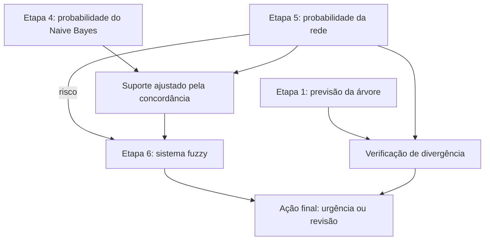

# Do simbólico à incerteza

**Infraestrutura digital básica nas escolas do Amazonas**  
Trabalho integrado de Fundamentos de Inteligência Artificial — Prof. Edjard Mota.

**Equipe:** Camila dos Santos Soares, Daniel Nunes Santos, José Eduardo Araujo Costa Melo, Nicoly Lima de Souza, Pedro Matheus Melo Pereira e Pedro Vinícius Díaz de Alencar.

[Relatório em PDF](relatorio/relatorio.pdf) · [Fonte LaTeX](relatorio/relatorio.tex) · [Integração dos modelos](integracao.py)

## Objetivo e dados

O projeto percorre as seis etapas, da árvore de decisão ao sistema fuzzy, usando o Censo Escolar 2025 do INEP, com recorte para escolas do Amazonas.

**Classificação:** a escola tem infraestrutura digital básica? A variável `infra_digital_basica` vale 1 quando há internet para alunos e pelo menos um indicador de equipamento para eles: desktop, portátil ou tablet. Essa definição não mede toda a qualidade da escola e não exige especificamente Wi-Fi.

**Regressão:** estimar a densidade de informatização, definida como a soma de desktops, portáteis e tablets para alunos dividida pelo número de salas utilizadas.

| Base | Escolas | Utilização |
|---|---:|---|
| `dados_etapa1.csv` | 5.562 | Classificação e Etapas 3–6; 1.007 positivas e 4.555 negativas |
| `dados_etapa2.csv` | 5.526 | Regressões com alvo contínuo na Etapa 2 |

O identificador `CO_ENTIDADE` não é uma pista do modelo. As colunas usadas para definir a classe também não entram como preditoras da classificação.

**Fonte registrada pela equipe:** [dados abertos do INEP](https://www.gov.br/inep/pt-br/acesso-a-informacao/dados-abertos), arquivo `Tabela_Escola_2025_V2.csv`, acesso em 29/10/2026. O recorte usa escolas do Amazonas em atividade. O escopo implementado utiliza INEP, sem junção com IBGE.

Os dois CSVs tratados estão no repositório. O microdado nacional fica fora do Git: **não é necessário baixá-lo para executar os notebooks**. Ele é necessário apenas para refazer a preparação dos dados.

## Conteúdo por etapa

| Notebook | Conteúdo |
|---|---|
| [Etapa 1](etapa1.ipynb) | Entropia e ganho, ID3 próprio, comparação com sklearn, cinco folds e monotonicidade |
| [Etapa 2](etapa2.ipynb) | Regressão univariada, multivariada com gradiente, Ridge e logística |
| [Etapa 3](etapa3.ipynb) | Conjunta, marginais, condicionais, cadeia, Bayes e independência |
| [Etapa 4](etapa4.ipynb) | MLE, MAP Beta(2,2), Naive Bayes próprio e EM Bernoulli |
| [Etapa 5](etapa5.ipynb) | DAG, CPTs, enumeração, comparação com pgmpy, d-separação e parâmetros |
| [Etapa 6](etapa6.ipynb) | Mamdani, comparação com limiar e integração adicional entre modelos |

## Como executar no VS Code / Windows

A verificação foi realizada com **Python 3.12**. Abra a pasta inteira do projeto no VS Code e instale as extensões **Python** e **Jupyter**.

No terminal PowerShell, a partir da raiz do repositório:

```powershell
python -m venv .venv
.\.venv\Scripts\python.exe -m pip install -r requirements.txt
```

Esses comandos não exigem ativar o ambiente. Abra cada notebook, clique em **Selecionar Kernel** e escolha o Python de `.venv`. Execute `etapa1.ipynb` a `etapa6.ipynb`, de cima para baixo. Para uma conferência limpa, use **Restart Kernel** e **Run All**, depois salve com `Ctrl+S`.

Para usar JupyterLab no navegador:

```powershell
.\.venv\Scripts\python.exe -m jupyterlab
```

### Linux / macOS

```bash
python3 -m venv .venv
.venv/bin/python -m pip install -r requirements.txt
.venv/bin/python -m jupyterlab
```

Os notebooks usam caminhos relativos à raiz do projeto. Se aparecer `FileNotFoundError`, confira a pasta de trabalho. Se aparecer `ModuleNotFoundError`, confira se o kernel selecionado é o mesmo ambiente no qual as dependências foram instaladas.

Versões usadas na verificação: NumPy 2.3.5, pandas 2.2.3, scikit-learn 1.8.0, pgmpy 1.1.2 e scikit-fuzzy 0.5.0. O `requirements.txt` lista as dependências, mas não fixa todas as versões. As sementes são fixas: 42 nas principais divisões e 0 nas árvores sklearn e na validação interna do Ridge.

## Resultados e avaliação

| Experimento | Protocolo | Resultado |
|---|---|---|
| Árvore própria, profundidade 3 | 5-fold estratificado | Acurácia média 87,65%; desvio de 0,32 ponto percentual |
| Árvore sklearn, entropia | Mesmos cinco folds | Acurácia média 87,67% |
| Classe majoritária | Mesmos cinco folds | Acurácia média 81,90% |
| Univariada, internet para alunos | Treino/teste 80/20; pista fixa | R² de teste 0,2372 |
| Multivariada por gradiente | Treino/teste 80/20 | R² de teste 0,3228 |
| Ridge | Lambda escolhido por CV no treino; teste 20% | R² de teste 0,3237; lambda ≈ 77,43 |
| Logística | Treino/teste estratificado 80/20 | Acurácia 88,40%; recall positivo 51,24%; AUC 0,8358 |
| Naive Bayes / NB com EM | Mesmo teste de 30%, sem estratificação | Acurácias 84,42% / 83,34% |
| Rede Bayesiana | Enumeração × pgmpy | Maior diferença nas consultas: 1,11 × 10⁻¹⁶ |
| Fuzzy e decisão dura, usando cadastro | 5-fold estratificado | Ambos com acurácia 82,29% |

**Esses resultados não formam um ranking geral:** os protocolos e as informações disponíveis diferem. O EM não melhorou a classificação neste experimento. Na Etapa 6, a AUC para ausência de infraestrutura foi 0,511 para a decisão dura, 0,666 para a probabilidade da rede e 0,656 para a urgência fuzzy. O benefício do fuzzy é a decisão por regras e graus de urgência; não houve melhora sobre a probabilidade original nessa métrica.

## Como os modelos se conectam

A sequência de estudo é: árvore → regressões → probabilidade → NB/EM → rede Bayesiana → fuzzy. A transferência efetiva de resultados na demonstração adicional está representada abaixo:



O sistema original recebe a probabilidade da rede e o número de escolas de treino com a mesma evidência. A confiança é uma **heurística de suporte**, não uma probabilidade de acerto.

Na seção final da Etapa 6, `integracao.py` usa todas as cinco pistas e uma divisão estratificada 70/30. Árvore, NB e CPTs são ajustados somente no treino. A concordância entre NB e rede modula o suporte do fuzzy; divergências entre árvore e rede encaminham a ação para revisão. Nas 1.669 escolas de teste, foram produzidas 1.271 ações de urgência alta, 383 médias e 15 encaminhamentos para revisão. São contagens de ações, não medidas de acerto. Essa demonstração não comprova ganho preditivo sobre os experimentos anteriores.

## Organização dos arquivos

| Caminho | Função |
|---|---|
| `etapa1.ipynb` a `etapa6.ipynb` | Execução, saídas e explicações de cada etapa |
| `dados_etapa1.csv`, `dados_etapa2.csv` | Bases tratadas |
| `scripts/` | Preparação dos dados e implementações auxiliares, incluindo `naive_bayes.py` |
| `fuzzy.py` | Sistema Mamdani e avaliação em cinco folds |
| `integracao.py` | Integração operacional de árvore, NB, rede e fuzzy |
| `gráficos/` | Figuras dos experimentos |
| `relatorio/relatorio.tex` | Artigo editável em LaTeX |
| `relatorio/relatorio.pdf` | Artigo compilado, com oito páginas |
| `relatorio/figuras/` | Figuras usadas pelo artigo |
| `requirements.txt` | Dependências Python |

O artigo contém cálculos dos três níveis da árvore, monotonicidade, resultados, limitações e apêndice de uso de IA. O apêndice distingue mensagens fornecidas pelos integrantes de prompts reconstruídos.

## Execução por scripts

Com o ambiente selecionado/ativado, execute na raiz:

```bash
python scripts/validacao_cruzada.py dados_etapa1.csv
python scripts/regressao_univariada.py dados_etapa2.csv
python scripts/comparar_pgmpy.py dados_etapa1.csv
python scripts/d_separacao.py dados_etapa1.csv
python fuzzy.py dados_etapa1.csv
python integracao.py
```

No PowerShell, sem ativação, substitua `python` por `.\.venv\Scripts\python.exe`.

### Regerar os dados — opcional

Coloque `Tabela_Escola_2025_V2.csv` na raiz e execute:

```bash
python scripts/etapa1_gerar_csv.py
python scripts/etapa2_gerar_csv.py Tabela_Escola_2025_V2.csv dados_etapa2.csv
```

A Etapa 1 informa ausentes e filtros. Na Etapa 2, o denominador precisa ser positivo; também são aplicados os filtros de ausentes, sentinela e limite de salas descritos no código. Se mudar a preparação, reexecute as etapas e atualize o artigo.

### Recompilar o relatório

Com uma distribuição LaTeX instalada:

```bash
cd relatorio
pdflatex -interaction=nonstopmode -halt-on-error relatorio.tex
pdflatex -interaction=nonstopmode -halt-on-error relatorio.tex
cd ..
```

Também é possível enviar `relatorio.tex` e a pasta `figuras` ao Overleaf, selecionando pdfLaTeX. Ao editar, mantenha fonte e PDF atualizados e confira o limite de páginas.

## Discussão e próximos experimentos

- **Desbalanceamento:** a classe majoritária já representa 81,90% da base; acurácia deve ser lida junto com recall e outras métricas.
- **Regressão:** as pistas têm poder explicativo limitado para a densidade de equipamentos. O pequeno ganho de Ridge e o R² baixo estão documentados.
- **EM:** o perfil resume informações já usadas pelo NB; sua inclusão reduziu a acurácia no teste observado.
- **DAG:** algumas independências assumidas não representam bem os dados. Por exemplo, a rede estima 0,148 para infraestrutura em escolas rurais, contra frequência empírica de 0,078. Variantes com `LOC → Y` e `BIB → LAB` devem ser comparadas por validação antes de substituir a estrutura atual.
- **Fuzzy e integração:** triângulos, limite de suporte e encaminhamento para revisão são escolhas da equipe. São regras interpretáveis, ainda sem validação por especialista do domínio.

Esses pontos delimitam o que os resultados permitem concluir. Melhorias de estrutura ou métricas precisam ser acompanhadas de nova avaliação e atualização dos notebooks e do relatório.

## Referências

- Russell, S.; Norvig, P. *Artificial Intelligence: A Modern Approach*. 4ª ed. Pearson, 2020.
- Zadeh, L. A. Fuzzy sets. *Information and Control*, 8(3), 338–353, 1965.
- Hüllermeier, E. Fuzzy machine learning and data mining. *WIREs DMKD*, 1(4), 269–283, 2011.
- INEP. Censo Escolar 2025, Tabela Escola V2. Fonte e acesso registrados acima.  
