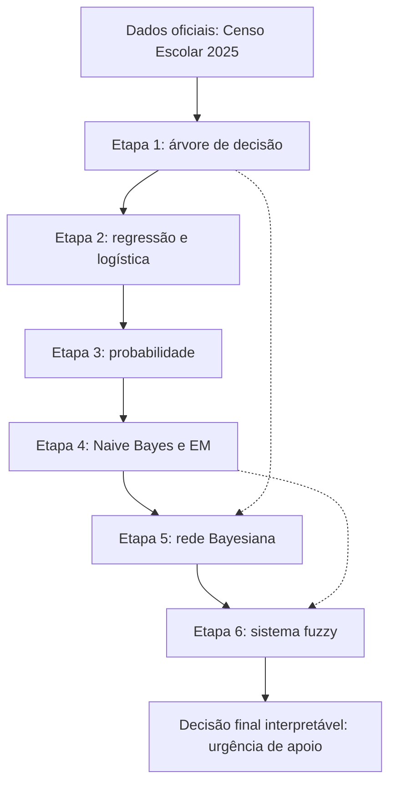

# Do Simbólico à Incerteza: pipeline completo de IA com dados do Censo Escolar

Trabalho Integrado de Fundamentos de IA (Prof. Edjard Mota).
Autoria: Camila dos Santos Soares, Daniel Nunes Santos, José Eduardo, Nicoly Lima de Souza, Pedro Matheus Melo Pereira, Pedro Vinícius Díaz de Alencar.

O repositório percorre as 6 etapas do pipeline do curso, da árvore de decisão à lógica fuzzy, sobre um único domínio de dados oficiais.

## Domínio e pergunta prática

- **Domínio:** Educação (P2), Censo Escolar 2025 do INEP, escolas do Amazonas.
- **Pergunta prática:** a escola tem infraestrutura digital básica?
- **Alvo binário (`infra_digital_basica`):** vale 1 quando a escola informa internet para os alunos **e** pelo menos um tipo de equipamento para eles (desktop, portátil ou tablet). Caso contrário, vale 0. Base: 5.562 escolas, 18,1% na classe 1.
- **Alvo contínuo (Etapa 2):** `DENSIDADE_INFORMATIZACAO` = equipamentos para alunos (desktop + portátil + tablet) por sala utilizada. Base: 5.526 escolas.

## Fonte dos dados

- Portal de dados abertos do INEP: <https://www.gov.br/inep/pt-br/acesso-a-informacao/dados-abertos>
- Arquivo usado: `Tabela_Escola_2025_V2.csv` (microdados do Censo Escolar 2025).
- Data de acesso: 29/10/2026

O arquivo bruto é grande e **não** está no repositório (está no `.gitignore`). Os CSVs já filtrados para o Amazonas, `dados_etapa1.csv` e `dados_etapa2.csv`, estão versionados, então os notebooks rodam sem baixar nada.

## Estrutura

```
.
├── etapa1.ipynb … etapa6.ipynb     # um notebook por etapa
├── dados_etapa1.csv                # base da Etapa 1 (usada também nas Etapas 3 a 6)
├── dados_etapa2.csv                # base da regressão linear (Etapa 2)
├── fuzzy.py                        # Etapa 6: sistema Mamdani (scikit-fuzzy)
├── gráficos/                       # figuras geradas pelos notebooks (inclui o DAG da Etapa 5)
├── scripts/                        # código das Etapas 1, 2, 4 e 5
│   ├── etapa1_gerar_csv.py         # microdados -> dados_etapa1.csv
│   ├── etapa2_gerar_csv.py         # microdados -> dados_etapa2.csv
│   ├── tabelas_pistas.py           # tabelas cruzadas para o cálculo manual de entropia
│   ├── learn_decision_tree.py      # LEARN-DECISION-TREE (ID3) do zero
│   ├── comparar_sklearn.py         # árvore própria x DecisionTreeClassifier
│   ├── validacao_cruzada.py        # 5-fold estratificado
│   ├── regressao_univariada.py     # fórmula fechada
│   ├── regressao_multivariada_gd.py# gradiente descendente do zero
│   ├── regressao_ridge.py          # regularização L2
│   ├── regressao_logistica.py      # sigmoide + gradiente
│   ├── em.py                       # EM (mistura de Bernoulli com 2 perfis ocultos)
│   ├── inferencia_enumeracao.py    # CPTs + inferência por enumeração (do zero)
│   ├── estimar_cpts.py             # estimação das CPTs (Laplace)
│   ├── d_separacao.py              # d-separação + teste de independência
│   └── comparar_pgmpy.py           # enumeração própria x pgmpy
├── requirements.txt
└── README.md
```

## Como reproduzir

Desenvolvido com Python 3.13/3.14. Todos os comandos abaixo partem da **raiz** do repositório (os notebooks usam caminhos relativos).

```bash
python -m venv .venv
source .venv/bin/activate          # Windows: .venv\Scripts\activate
pip install -r requirements.txt
jupyter lab                        # ou abra os notebooks no VS Code
```

Execute `etapa1.ipynb` a `etapa6.ipynb` em ordem. Todas as sementes são fixas (`42`).

### Regerar os CSVs a partir dos microdados (opcional)

1. Baixe `Tabela_Escola_2025_V2.csv` no portal do INEP e coloque-o na raiz.
2. Etapa 1: edite `CAMINHO_ENTRADA` em `scripts/etapa1_gerar_csv.py` e rode `python scripts/etapa1_gerar_csv.py`. O script grava `dados_etapa1.csv`.
3. Etapa 2: `python scripts/etapa2_gerar_csv.py Tabela_Escola_2025_V2.csv dados_etapa2.csv`

### Rodar os scripts fora dos notebooks

```bash
python scripts/learn_decision_tree.py dados_etapa1.csv --max-depth 3
python scripts/comparar_sklearn.py dados_etapa1.csv
python scripts/validacao_cruzada.py dados_etapa1.csv
python scripts/regressao_logistica.py dados_etapa1.csv
python scripts/inferencia_enumeracao.py dados_etapa1.csv "infra_digital_basica | TP_LOCALIZACAO=2, IN_LABORATORIO_INFORMATICA=1"
python scripts/d_separacao.py dados_etapa1.csv
python scripts/comparar_pgmpy.py dados_etapa1.csv
python fuzzy.py dados_etapa1.csv
```

## Resumo por etapa

| Etapa             | Conteúdo                                                                                          | Resultado principal                                                                                                                                  |
| ----------------- | ------------------------------------------------------------------------------------------------- | ---------------------------------------------------------------------------------------------------------------------------------------------------- |
| 1. Simbólico      | Entropia e ganho calculados à mão para 3 níveis; ID3 do zero; comparação com scikit-learn; 5-fold | Raiz: `IN_LABORATORIO_INFORMATICA` (GI = 0,1915). Profundidade 3: 87,65% ± 0,32 (ID3 próprio) contra 87,67% (sklearn) e 81,90% (classe majoritária). |
| 2. Linear         | Univariada, multivariada com GD, Ridge, logística                                                 | R² de teste: 0,24 (univariada), 0,32 (multivariada), 0,32 (Ridge, λ ≈ 77). Logística: acurácia 88,4%, AUC 0,836, recall 51,2% no teste.              |
| 3. Probabilidade  | Conjunta, marginais, condicionais, regra da cadeia, Bayes, independência condicional              | P(infra \| laboratório) = 66,8%. Laboratório e biblioteca **não** são condicionalmente independentes dada a classe.                                  |
| 4. Probabilístico | MLE, MAP Beta(2,2), Naive Bayes do zero, EM com perfil oculto                                     | MLE 0,1862 e MAP 0,1864. Naive Bayes 84,42% e Naive Bayes + EM 83,34% (divisão única 70/30).                                                         |
| 5. Rede Bayesiana | DAG de 6 nós e 8 arestas, CPTs, enumeração do zero, pgmpy, d-separação, parâmetros                | 29 parâmetros livres contra 127 da conjunta (economia de 77,2%). Enumeração confere com a marginalização da conjunta (~1e-16).                       |
| 6. Fuzzy          | Mamdani com 3 variáveis, 3 regras, entrada vinda da Etapa 5                                       | Com o cadastro, fuzzy e limiar 0,5 empatam em acurácia (82,29%), mas o AUC da urgência fuzzy é 0,656 contra 0,511 da decisão dura.                   |

## Integração do pipeline



As setas tracejadas indicam reaproveitamento: o alvo e os atributos da Etapa 1 definem a rede da Etapa 5, e as probabilidades aprendidas alimentam o sistema fuzzy da Etapa 6, que devolve uma urgência de 0 a 100 com rótulo (baixa, média, alta) e consciência de quantas escolas sustentam cada estimativa.

## Limitações conhecidas

- **Etapa 2:** os R² ficam abaixo de 0,35. Os 6 atributos são quase todos binários e explicam pouco da densidade de equipamentos por sala.
- **Etapa 4:** o perfil oculto do EM resume 3 indicadores que o Naive Bayes já recebia e não melhorou a acurácia.
- **Etapa 5:** o DAG não tem as arestas `LOC → Y` e `BIB → LAB`. Os testes de independência nos dados as sugerem, e a rede erra consultas sobre localização (P(Y=1 \| rural) é 0,148 na rede e 0,078 nos dados).
- **Etapa 6:** o erro do DAG passa para o sistema fuzzy, e os pontos dos triângulos de pertinência foram escolhidos pela equipe, não aprendidos dos dados.

## Uso de chatbot

Chatbots foram usados como apoio para gerar código. Os prompts estão documentados no apêndice do relatório.

## Referências

- Russell, S., & Norvig, P. _Artificial Intelligence: A Modern Approach_. 4ª ed., Pearson, 2020 (caps. 18 a 20).
- Zadeh, L. A. Fuzzy sets. _Information and Control_, 8(3), 338–353, 1965.
- Hüllermeier, E. Fuzzy machine learning and data mining. _WIREs DMKD_, 1(4), 269–283, 2011.
- Bibliotecas: numpy, pandas, scipy, scikit-learn, scikit-fuzzy, pgmpy, matplotlib.
